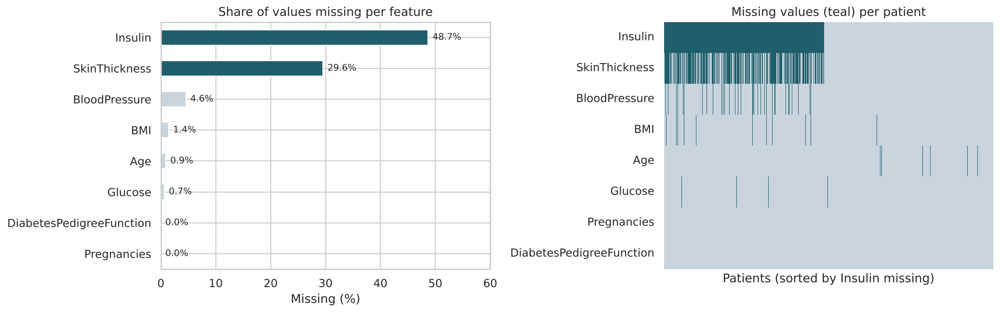
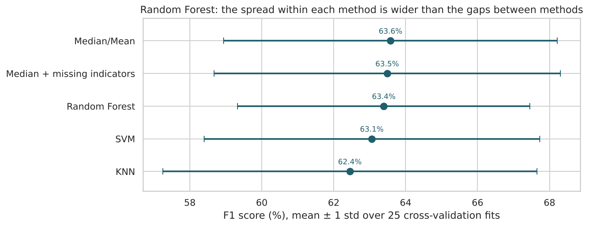
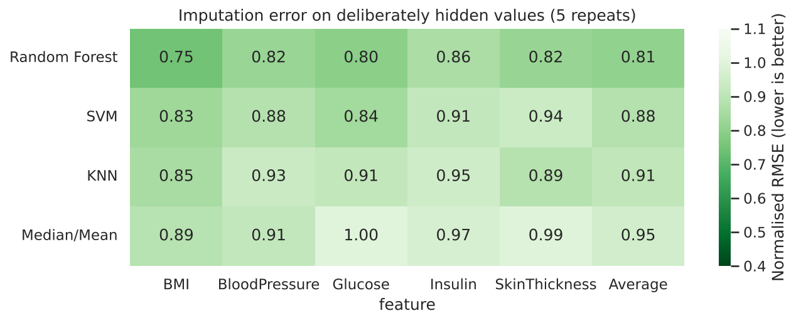

# Machine Learning-Based Imputation Techniques: Analysis and Study

Code for my published IEEE paper, **[Machine Learning-Based Imputation Techniques Analysis and Study](https://ieeexplore.ieee.org/document/10739330)** (Agnal Varghese Pindiyan and Pramila R.M., CHRIST University).

**Question:** When a medical dataset has missing values, does the choice of imputation method change how well a classifier predicts diabetes?

**Short answer:** For classification, barely. The differences between imputation methods (about 1 F1 point) are much smaller than the normal variation between data splits (about ±4.7 points). For recovering the missing values themselves, Random Forest imputation is the most accurate.



## Data
- **Source:** [Pima Indians Diabetes Database](https://www.kaggle.com/datasets/uciml/pima-indians-diabetes-database) (Kaggle / UCI)
- **Size:** 768 patients, 8 health measurements, diabetes outcome (34.9% diabetic)
- **Missing values:** recorded as 0 in the raw data (impossible for glucose, blood pressure, skin thickness, insulin, BMI or age). 10.7% of all values are missing, mostly Insulin (48.7%) and SkinThickness (29.6%).

## What's in the notebook

### Part A: the paper's experiment
My four original notebooks (one per imputation method) combined into one:
- **Imputation methods:** median/mean, KNN (`KNNImputer`), Random Forest and SVM (`IterativeImputer` with `RandomForestRegressor` / `SVR`), each fitted on the training set only.
- **Classifiers:** KNN, Random Forest and SVM, tuned with `GridSearchCV` and stratified 5-fold cross-validation.
- **Metrics:** mean accuracy, precision, recall, F1, and test ROC-AUC.

Published results (mean F1, Table I of the paper):

| Imputation | KNN | Random Forest | SVM |
| --- | --- | --- | --- |
| KNN | 61.52% | 65.78% | 60.20% |
| Random Forest | 63.21% | **66.48%** | 57.36% |
| SVM | 65.49% | 66.13% | 60.56% |
| Median/Mean | 64.40% | 66.35% | 60.41% |

### Part B: revisiting the results (2026)
Two questions I would add now:

**1. Are the differences bigger than noise?** I re-evaluated every combination with 5 × repeated 5-fold cross-validation, refitting the imputer on each training fold, and reported the spread as well as the mean.



For the Random Forest classifier, all imputation methods land between 62.4% and 63.6% F1, while each method varies by about ±4.7 points across folds. Adding missing-value indicators, or skipping imputation with gradient boosting (which handles missing values natively), doesn't stand out either.

**2. How accurately does each method recover the true values?** I hid 10% of the values in complete records, imputed them, and measured the error against the real values.



Random Forest imputation has the lowest error (0.81 normalised RMSE, against 0.95 for the median, about 15% lower).

## Conclusions
1. **Random Forest is the most reliable classifier** here: best or near-best F1, and the highest ROC-AUC under every imputation method.
2. **For prediction, the imputation method matters little on this dataset.** The small differences in the paper are within normal random variation.
3. **For the imputed values themselves, Random Forest imputation is most accurate.** That matters when imputed values are reported or used directly.
4. **Practical rule:** use simple median imputation inside a pipeline for predictive models; use Random Forest imputation when the imputed values themselves matter.

## Limitations
- One dataset of 768 patients.
- Part B hides values completely at random, which is easier than the real pattern (Insulin and SkinThickness are often missing together).
- Part A uses a smaller hyperparameter grid than the original notebooks to keep run time to a few minutes, so its numbers differ slightly from the paper.

## Files
| File | What it is |
| --- | --- |
| `imputation_study.ipynb` | Full study: Part A (paper) and Part B (revisit) |
| `diabetes1.csv` | Dataset used in the paper |
| `images/` | Charts used in this README |
| `requirements.txt` | Python packages |

## How to run
```
pip install -r requirements.txt
jupyter notebook imputation_study.ipynb
```
Run time is about 10 minutes on a laptop.

**Tools:** Python, Pandas, NumPy, Scikit-learn (KNNImputer, IterativeImputer, GridSearchCV, StratifiedKFold), Matplotlib, Seaborn
